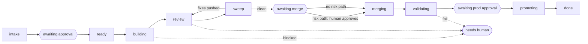

<!-- markdownlint-disable-next-line -->
<p align="center"></p>

# chuck

chuck is a delivery loop for AI coding agents. It takes a GitHub issue and
moves it through intake, build, review, sweep, merge, validate and promote.
Each stage runs as a fresh Claude Code session on its own short-lived Fly
Machine, which reports a schema-checked verdict and is destroyed. Every
transition between stages is decided by ordinary Go code, never by a model.

The idea in one line: **agents do the work, code decides what happens next,
and a person approves anything risky.**

> **Status: under construction.** The design is settled and the core is
> built and tested: config, state store, the transition engine, stage
> prompts and verdict schemas, the GitHub client with a hardened webhook
> receiver, the executor and tick that drive it, and the worker launcher
> with its run API and watcher. The pieces that make it run end to end
> (Claude proxy, worker entrypoint and dashboard) are still being built, so chuck does not yet move real issues. Progress is
> tracked on [issue #17](https://github.com/showmethebots/chuck/issues/17).
> Production today serves `/healthz` and stores signed GitHub webhook
> deliveries; the loop stays off until its secrets are set.

## Why

Letting an agent open, review and merge its own pull requests is useful
and dangerous in the same breath. The usual failure is not a bad diff. It
is an agent, or a prompt injected into one through an issue comment,
deciding on its own that a change is ready. chuck keeps that decision out
of the model's hands:

- A worker can only *report*. It never changes labels, merges or deploys.
- The merge gate is a commit status (`chuck/loop`) that only chuck can
  set, required by the repo's branch ruleset with no bypass actors.
- A pull request touching a risk path (migrations, dependencies, CI, the
  loop's own config) waits for a human approval of the exact commit that
  was reviewed.

## The loop



Hexagons are where a person can be asked to approve. Any stage can escalate
to `needs-human`. The full state machine, including every entry, exit and
escalation, is in the
[design spec](docs/superpowers/specs/2026-11-03-delivery-loop-design.md).

## Design choices worth a look

| Where | What it does | Why |
| --- | --- | --- |
| `internal/loop` | `Transition` is a pure function: item, config, input and gathered facts in; state changes and effects out. | Every rule is a table test. `TestPackageImportsNoIO` fails the build if the package imports a network, database or filesystem package. |
| `internal/loop` | Risk-path hold. `chuck/loop` turns `success` only on a clean sweep or a human approval of the reviewed head. | A later, prompt-injected stage cannot merge a migration once checks go green. Approval of any other commit is ignored. |
| `internal/engine` | The new state and its transition row are committed before any GitHub call. A failed effect leaves the item where it was committed, with the error on the row, and the tick retries it; after three failing ticks the item goes to a human. | chuck is never behind its own database, and every effect is safe to run twice: labels converge, a mention looks for its own marker, a merge re-reads the PR and never merges a head that moved. |
| `internal/engine` | GitHub does not retry a failed webhook delivery, so every tick also replays what a lost one would have done: a human's label or approval, a merge, a deploy run. | A dropped delivery costs one tick of delay, not a stuck item. |
| `internal/github` | Webhooks are checked against GitHub's published `hooks` IP ranges before the body is read, then by HMAC signature. For the events the loop acts on, the signed payload must also match the unsigned event header. | Layers fail closed: an empty secret rejects everything, and a captured body cannot be replayed as one of the events the loop acts on. |
| `.github/workflows/hook-ranges.yml` | A weekly job compares the built-in IP list with GitHub's and opens an *issue*, not a PR. | Actions never gets permission to create or approve PRs, so no workflow can satisfy the human merge approval. |
| `internal/github` | Worker tokens are minted per stage from a fixed permission set, and a token returned with any extra permission is refused. Symlinks are never followed when reading `loop.json`. | Least privilege per run, checked rather than assumed. |
| `internal/memory` | Run tokens and session cookies are stored only as sha256. SQLite runs in WAL mode on one connection, replicated by Litestream. | A copy of the database or its backup holds no usable credential. |
| `internal/config` | Config decodes strictly (unknown fields are errors) and reports every problem at once. Secrets may appear only as `${VAR}` references. | A typo can't silently turn a safety setting off, and config never holds a secret. |
| `.github/workflows` | Every Action is pinned to a full commit SHA. | The deploy job holds a Fly token, so a moved tag must not be able to reach it. |

The rules the code depends on are written down as invariants in
[AGENTS.md](AGENTS.md).

## How it was built

chuck is built with Claude Code, under the same discipline it is meant to
enforce. Each change starts as an issue, lands as a pull request with the
issue number in its title, and gets a code review and security review in a
fresh session before a person merges it. Commit messages record which
review findings each commit closes, so the history shows the review
rigor as well as the result. The shared review skills live in
`.claude/skills/`, vendored from
[cwinters8/agent-skills](https://github.com/cwinters8/agent-skills).

Earlier designs are kept rather than deleted. chuck started as a
project-manager agent (Haiku triage, Slack, routing tiers) and was
redesigned as the delivery loop in November 2026;
[docs/superpowers/README.md](docs/superpowers/README.md) explains which
documents are current and which are history.

## Layout

```text
cmd/chuck/          entrypoint: `run` (server), `validate` (config and loop.json check)
internal/config/    config/chuck.yaml and per-repo .claude/loop.json: strict decoding, validation
internal/loop/      the pure Transition function, stage prompts and verdict schemas
internal/engine/    the I/O around Transition: webhook mapping, facts, the effect executor, the tick
internal/github/    GitHub App client, worker tokens, webhook receiver and IP allowlist
internal/memory/    SQLite state (WAL, embedded migrations)
internal/web/       HTTP server: /healthz, the webhook mount, the worker run API, heartbeat
internal/worker/    stage workers: launchers, run API, watcher, trusted text
config/             chuck.yaml (chuck-wide, changed by PR) and loop.schema.json (for consumers)
deploy/             fly.toml, Litestream config, entrypoint, worker image, restore check
docs/               human steps, specs and plans
```

## Development

Requires Go (the version in `go.mod`). Docker is needed only for the image
targets, and golangci-lint for `make lint`.

```sh
make test       # vet + race tests
make lint       # golangci-lint
make validate   # check the shipped config
make run        # chuck locally, state in ./data, no Litestream
make smoke      # build image, run the Litestream restore check
make skills-check  # vendored agent skills match the pinned ref
make skills-sync   # re-vendor them after bumping the ref
```

### Running locally

`make run` with no `.env` starts chuck without the webhook, which is enough
to see `/healthz`. To receive real GitHub traffic you need your own GitHub
App and a tunnel; the one-time setup is in
[docs/phase-1-human-steps.md](docs/phase-1-human-steps.md) section 1.5.
Each session after that:

1. `cp .env.example .env` the first time, then fill in what you need. An empty
   file runs chuck without the webhook. Variables set in your shell override `.env`, and so does the
   `CHUCK_HEARTBEAT=5s` that `make run` sets.
2. For real GitHub traffic, start the tunnel:
   `ngrok http --url=<your-domain> 8080`.
3. `make run` from the repo root.

Webhook deliveries made while the tunnel is down fail and are not retried;
redeliver them from the dev App's **Advanced** → **Recent Deliveries**.

Deploying: see [deploy/README.md](deploy/README.md).

## License

[MIT](LICENSE).
